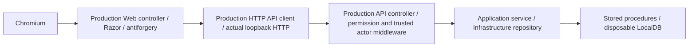

# Step 144 — PC07.01 integrated acceptance and deployment readiness

2026-10-22. **Integrated isolated browser → production Web HTTP client → production API → SQL acceptance: PASS at desktop/mobile widths, two new cases.** Migrations 0089/0090 executed only in newly generated disposable LocalDB fixtures. **Existing clinical tenant deployment: not executed or freshly attested. PC07.01: PARTIAL. Inventory before/after: 10 mandatory-gap IDs / three packages.**

## 1. Checkpoint, branch and authorization

Read AGENTS.md and [Step 143](210-step143-pc07-01-compliance-authority-interval-implementation.md) as the controlling implementation/evidence source. Recorded branch/HEAD/status once: **`main`**, **`0a561092e595d2d963de40065a9eb0727094fa92`**, **clean**. The earlier Step 143 branch was absent when checked; its historical report is not the current branch state.

Because closing the integrated-path gap required adding verification code, created/verified **`feature/step-144-pc07-01-integrated-acceptance` before that edit**, following the conservative new-branch boundary. No product implementation fix was required. No prior changes overwritten, staging, commit, merge, reset, cleanup, push or remote operation. Only a new test harness and this report are deliverables; application code, migrations and configuration are unchanged.

Step 144 section 3 permits isolated execution where test writes are already authorized. Step 143 explicitly authorized generated disposable-database fixtures, migrations and test writes; that authorization and this conditional continuation apply to the same test infrastructure. They do **not** authorize any existing clinical tenant deployment or records. No existing tenant, production database, service or permissions were modified. Temporary test hosts were started/stopped normally; no running application service was restarted.

## 2. Migration readiness — read-only inspection before isolated execution

| Item | Finding |
|---|---|
| Ordering | Manifest appends **0089-medication-compliance-assessments**, then **0090-prescription-paper-interval**, after 0088. Distinct sequential IDs; 0090 does not consume the new assessment column but deployment follows manifest order |
| 0089 dependencies | Existing PatientMedication/Patient/AuditLog/ApplicationUser, unique MedicationUid and effective 0087 plan procedures. Adds nullable ComplianceAssessment, JSON constraint and retained revision table/FK; replaces the five medication Get/List/Create/Update/Discontinue procedures |
| 0090 dependencies | Existing prescription foundation and effective 0086 (including earlier date, generic-name, private-note and signing contracts). Adds nullable paper/interval fields and restrictive checks; replaces Get/List/CreateDraft/UpdateDraft/Finalize/SignAndFinalize |
| Compatibility | Nullable additions without clinical defaults/backfill; old rows remain readable, old client omissions preserved, existing finalized artifacts not rewritten. Legacy and broader negative/lifecycle evidence from Step 143 retained. SQL JSON support and existing dependency functions are required; isolated current LocalDB execution passed, not a fresh certification of another SQL engine |
| Destructive scope | No table/column/clinical-record deletion or truncation; no historical migration edits. CREATE OR ALTER changes only intended existing procedure definitions. New revision history retained |
| Raw-script idempotency | **Not idempotent:** unguarded column/table/constraint additions must not be rerun manually. Procedure CREATE OR ALTER alone does not make the whole migration replay-safe |
| Tracking and recovery | Existing runner reads SchemaMigration IDs/hashes, rejects mismatch, and commits each migration's batches plus its ledger entry in a transaction. 0089 may remain committed if later 0090 fails; no automatic down migration. Do not manually fabricate ledger rows or alter migration history. Retained Step 139 recovery principles apply |

Targeted source inspection: FileTenantDatabaseMigrationSource, relevant TenantDatabaseMigrationRunner tracking/transaction lines, and migrations/manifest. No provision command was run. Fixture setup applies selected dependency scripts directly, **not the full platform provisioning/ledger workflow**; this difference is retained as a deployment qualification.

**Readiness disposition:** PASS for the tested disposable schema/contracts. Existing development deployment remains gated by a fresh exact tenant/database identity, actual pending IDs/hashes and compatibility prerequisites, verified backup/recovery, controlled matching API/Web/JS rollout, and explicit owner execution authorization. No assertion that an existing tenant currently has exactly two migrations pending; its live state was not queried here. Do not rerun migrations because this report lacks live attestation.

## 3. Safe disposable target and actual migration execution

Reused `Step143PlanDatabase` and `Step143OrderDatabase` fixture initialization only; did not invoke their prior test suites. Before opening either fixture, the new harness rejects connection overrides unless they use **integrated-security LocalDB with master as the setup catalog**. Existing fixture code creates unique controlled database names and changes clinical schemas/data only inside those generated databases. Fixture disposal validates names before dropping the owned disposable databases.

Actual SQL identity checks returned **SERVERPROPERTY('IsLocalDB') = 1**, with DB_NAME() matching the expected generated name:

| Tested clinical source | Actual primary database | Fixture scope |
|---|---|---|
| Medication plan/compliance | `MicroEMR_Step97_34e53f4259a549c9a64fba40340a4afd` | Plan fixture applies prerequisites and 0089 to its generated primary/paired secondary databases |
| Prescription order | `MicroEMR_Step87_0ee33af220eb4d91834cf686e2b13235` | Prescription fixture applies prerequisites and 0090 to its generated primary/paired secondary databases |

These are **two independent fixture tenants/patient datasets**, not one linked medication/order clinical record. No association or value copy is inferred between them. Existing tenant factories resolve the owned connections. Four generated databases in total (including paired secondary scope fixtures), cleaned up through successful fixture disposal. No backup of existing clinical data was needed for these disposable fixtures.

New synthetic plan rows/assessment revisions and prescription Drafts were created only within these fixtures under the existing isolated-test authorization. No SQL credentials/configuration or clinical content from an existing tenant were inspected or logged.

## 4. New integrated acceptance — executed

Added `tests/MicroEMR.Api.Tests/Step144IntegratedAcceptanceTests.cs`. **No mocked clinical transport, service, repository or SQL response** is used for these cases:



Real PatientMedicationApiClient and PatientPrescriptionApiClient are registered; prescription requests use the production WebApiBearerTokenHandler. A delegating observer records actual HTTP method/path/status and forwards every request to the real API. SQL-backed reads and audit/history assertions independently verify the effects of browser saves, not merely the displayed HTML.

**Authentication boundary:** isolated fixture authentication supplies tokens/permissions for the known writer/reader identities; no real OIDC server/refresh or clinic login is tested. Plan and prescription API hosts use their respective fixture identities/tenants. Existing production authorization and trusted clinical actor resolution execute. The unrelated chart redirect destination is a fixture landing page; resource Edit/Details pages are production views backed by real API reads. This is not whole-chart navigation or real-world deployment attestation.

| Workflow | Actual evidence at both widths |
|---|---|
| Compliance create/save/reload | Normal Web form/antiforgery POST reaches actual API **201**; SQL holds Compliant, exact explanation, trusted assessor and revision 1. Edit reload reads the stored state |
| Validation | Missing time offset produces visible server-side Web validation and no outbound PUT/revision; retained explanation remains readable. Interval 0, -1 and 1.5 fail actual native browser validity. Do not label browser/Web prevention as newly observed API rejection; Step 143 API/raw-SQL rejection evidence remains controlling |
| Compliance revision/history | Browser changes to Unknown with unknown assessment instant; actual API/SQL save produces revision 2, old Compliant retained. Production Details displays the real current state and expanded persisted history |
| Paper requirement / interval | Production options exactly Not recorded/Yes; browser saves Yes + 7 days. Actual API **200** and direct SQL read confirm both facts; fresh Edit/Details reload displays them. Existing unrelated prescription content remains available |
| Permissions / no mutation | Reader can view the owned plan but browser assessment save reaches actual API **403**; SQL RowVersion and two-revision history remain unchanged. Reader prescription Edit is **403** at production Web permission boundary, with order RowVersion unchanged |
| Audit | Actual SQL plan clinical audit contains precisely the two successful clinical writes. Read/denied attempts do not become extra assessment revisions |

**Result: 2 passed, 0 failed, 0 skipped** — `BrowserApiSqlSaveReloadHistoryValidationAndPermissions(width: 390/1440)`. First execution passed; no passing Step 143 suite was replayed. Evidence `.tmp/step144/step144-integrated.trx` and `.tmp/step144-integrated.log`, including actual database identity and API/SQL success messages.

Build of the affected test project to existing isolated artifact output succeeded, **zero errors and six retained NU1900 vulnerability-metadata warnings**. Initial test-only analyzer warning was corrected before test execution. Build log `.tmp/step144-build.log`. No full solution build, dependency installation or browser download.

```powershell
$env:PLAYWRIGHT_BROWSERS_PATH = Join-Path $PWD '.tmp/step116-browsers'
dotnet test tests/MicroEMR.Api.Tests/MicroEMR.Api.Tests.csproj --no-build --no-restore --artifacts-path .tmp/step138/build --filter 'FullyQualifiedName~Step144IntegratedAcceptanceTests' --logger 'trx;LogFileName=step144-integrated.trx' --results-directory .tmp/step144 --logger 'console;verbosity=normal'
```

## 5. Desktop/mobile DOM, keyboard and visual evidence

Existing Chromium infrastructure, production local Bootstrap/theme CSS and emitted JS used at **1440×900** and **390×844**. New workflow checks assert label associations, keyboard Tab reachability to assessment time, control center hit-testing after scrolling, absence of unintended document horizontal overflow and read-only Details controls. Actual error feedback and persisted values are asserted independently of images.

Six useful screenshots captured under `.tmp/step144/screenshots/` and inspected with the image viewer:

- `assessment-validation-390.png`, `assessment-validation-1440.png` — missing-offset summary/inline feedback and retained entered content.
- `assessment-history-390.png`, `assessment-history-1440.png` — actual SQL-backed current state, trusted actor/time and expanded two-revision history.
- `order-details-390.png`, `order-details-1440.png` — persisted Yes/7-day values and existing prescription content.

New content is readable in inspected states; mobile text wraps without document horizontal overflow or overlapping controls. App-shell captures show the current scroll-container viewport, not stitched captures of every lower field. Scrolling/hit-testing supplies separate reachability evidence. **No screenshot-baseline comparison PASS:** no approved baseline exists. No full accessibility scanner/screen-reader certification or subjective clinical acceptance is inferred from DOM/images. Screenshot review is Codex inspection of captured output, not an owner UI PASS.

## 6. Reused evidence and pending owner observations

Retain Step 143's **30 backend/API/SQL + 10 rendering + 10 Chromium PASS** outcomes, eight frontend PASS and TypeScript PASS. These are reused, not rerun or combined into a fictional single execution. Existing finalization/correction, omission/clear, concurrency, cross-patient/tenant and audit rollback results remain controlling; the new cases fill the previously separated browser/API/SQL evidence gap. No lifecycle/security suite replay was needed.

| Owner-facing wording/layout observation | Reconciliation |
|---|---|
| Prescription | **PENDING — subjective owner confirmation.** New integrated label/value persistence and Details appearance PASS; owner understanding/acceptance is not supplied |
| Medication plan | **PENDING — subjective owner confirmation.** Real assessment, unknown, actor/time/history, error feedback and rendering PASS; not an owner clinical wording judgment |
| Allergy | **PENDING — subjective owner confirmation.** Unchanged and outside new execution; retained Step 138–140 evidence preserved |

No new full manual checklist. Ask only whether the three existing wording/meaning observations are acceptable or what specific issue remains. Preserve the four recorded Drug Description owner PASS results and all earlier qualified closures; do not reopen brand/private-note/boundary acceptance.

## 7. Status, remaining actions and next step

**Integrated isolated acceptance: PASS. Existing-tenant deployment: NOT EXECUTED / status not freshly verified.** Missing prerequisites for any existing-tenant execution are its current owner-selected identity/pending ledger/hashes, recovery/backup evidence, matching application rollout plan and **explicit authorization naming that tenant and deployment operations**. Isolated-test authorization is not deployment authorization. Real OIDC/session refresh, full chart navigation, screenshot regression comparison and subjective acceptance remain outside these two cases.

**PC07.01 remains PARTIAL. Inventory before: 10 mandatory-gap IDs / three packages; after: 10 / three packages.** DE09.004 SATISFIED — VERIFIED qualified and all prior closures preserved. DE09.018/.028 gain real isolated integrated persistence/read evidence but do not establish owner/deployed acceptance. DE09.027 retains restricted native Yes/Not recorded qualification; no independently authoritative electronic declaration/transmission capability is added. Immunization dose, reference integrations, pickup-time policy, CPP audience/Family evidence and release/source qualifications remain unchanged.

**Recommended Step 145:** record only the three subjective owner observations; if an existing development deployment is wanted, verify its exact target/migration/application state read-only and prepare the concrete remaining rollout/recovery procedure for explicit authorization. Do not reapply already recorded migrations or repeat the new passing integrated cases without a relevant change. Keep remaining implementation dependencies grouped; no new one-field investigation.

Changed files: only this report and `tests/MicroEMR.Api.Tests/Step144IntegratedAcceptanceTests.cs`. `.tmp/step144` and build/log outputs are ignored local evidence. Final checks: no product/SQL/config changes; diff/new-file whitespace, report links and evidence targets checked. **Stop after report and authorized isolated verification. No commit/push/merge/reset/clean.**
